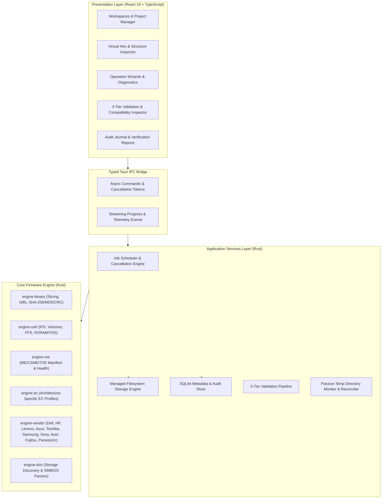
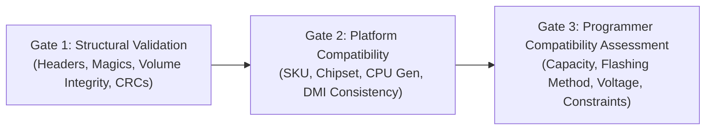

# System Architecture & Technical Specification

## 1. Architectural Overview

The workstation is an offline-first, high-performance Windows desktop application engineered for laptop firmware inspection, extraction, and authorized repair. It enforces strict separation of concerns across three principal layers:



---

## 2. Firmware Artefact Taxonomy

To prevent data corruption, the engine strictly distinguishes six types of firmware artefacts:

1. **Vendor Update Payloads:** OEM packaging containers (`.exe`, `.cap`, `.fd`, `.hdr`, `.FL1`) that contain compressed, encrypted, or staged update components. These cannot be flashed directly to hardware.
2. **BIOS Regions:** The primary UEFI/BIOS image section within an SPI flash image, excluding the Intel Flash Descriptor, ME, and GbE regions.
3. **EC Regions / Slices:** Microcontroller code targeted for Embedded Controllers / Super I/O chips (ITE, ENE, Nuvoton, Microchip).
4. **Complete SPI Images:** Full-chip binary dumps containing all functional regions (IFD + ME + BIOS + GbE + PDR/EC) exactly matching flash chip physical capacity (e.g., 4MB, 8MB, 16MB, 32MB).
5. **Reconstructed Images:** Firmware images assembled from repaired or clean donor parts, undergoing structural synthesis but not yet assessed for hardware deployment.
6. **Programmer-Compatible Images:** Images assessed for exact flash chip capacity, layout alignment, and programmer requirements, verified ready for external hardware programming (e.g. CH341A, RT809H, SVOD4) or host-based flashing.

---

## 3. Core Engine Technical Specifications & Preconditions

### 3.1 Intel Flash Descriptor (IFD) Specification
- **Signature Constant:** `0x0FF0A55A`.
- **On-Disk Byte Representation (Little-Endian):** Located at offset `0x10` (16 bytes decimal), the exact bytes must read:
  ```text
  Offset 0x10: 5A A5 F0 0F
  ```
- **Parsing Assumptions & Boundary Conditions:**
  - Offset `0x00`–`0x0F` (16 bytes): Reserved header block.
  - Offset `0x10`–`0x13`: 4-byte signature. If bytes differ from `5A A5 F0 0F`, the file is **not** an IFD-based full SPI dump (e.g., it is a standalone BIOS region, AMD platform dump, vendor update payload, or corrupted descriptor).
  - Offset `0x14` onwards: Descriptor Map (FLMAP0, FLMAP1, FLMAP2) defining component counts, master access permissions (Read/Write access for Host CPU, ME, GbE), and base/limit addresses for regions:
    - Region 0: Flash Descriptor
    - Region 1: BIOS
    - Region 2: Intel ME / CSME
    - Region 3: GbE (Gigabit Ethernet)
    - Region 4: Platform Data Region (PDR) / EC
- **Flashing Context Distinction:**
  - **Host-Based Flashing (Intel FPT / OEM In-OS Flasher):** Operates under Host CPU execution and is strictly bound by IFD Master Read/Write permissions. If BIOS write permission is locked, host-based flashing will be blocked.
  - **External SPI Programming (Hardware Programmer on Physical Pins):** Operates electrically via programmer clips (e.g. CH341A, RT809H, SVOD). Ignores chipset IFD Master permissions, but requires physical compatibility: correct operating voltage (1.8V vs 3.3V), physical chip capacity matching, and Quad-Enable (QE) bit retention.

### 3.2 Intel ME / CSME Compatibility Preconditions
Region replacement (Clean ME injection) must never be performed via naive byte-copying. Before any replacement, the engine enforces strict pre-flight compatibility:
1. **Major Generation Match:** The clean repository region must match the source ME major generation (e.g., ME 9.x, 10.x, 11.x; CSME 12.x, 14.x, 15.x, 16.x).
2. **Platform SKU Match:** Consumer, Corporate, Slim, Lite, and Server/SPS SKUs are distinct and cannot be interchanged.
3. **Chipset Stepping & Silicon Compatibility:** Verification against chipset ID and stepping flags in the Flash Partition Table (FPT) and manifest.
4. **Configuration Parameter Preservation:** Extract and transfer system-specific FIT (Flash Image Tool) configuration parameters, power management profiles, GPIO strap settings, and OEM public key hashes from the source dump into the clean target.
5. **Manifest & Hash Validation:** Verify integrity of all partition hashes in the clean region before synthesis.

### 3.3 Embedded Controller (EC) Validation Architecture
- **Architecture-Specific Validation Profiles:** SIO/EC controllers do not share a universal combination of entry point, vector table, and padding patterns. Validation relies on architecture-specific profiles:
  - *ITE Profile (e.g., IT8586E, IT8587E):* 8051-derivative architecture, resets to vector `0x0000`, checks internal flash jump table and manufacturer payload footer.
  - *ENE Profile (e.g., KB9012, KB9022):* 8051 or ARC-based, checks specific bootstrap vector sequence and code block sizing.
  - *Nuvoton Profile (e.g., NPCE288, NPCE388):* ARM Cortex-M or proprietary core, vector table initial stack pointer and reset handler alignment.
  - *Microchip / SMSC Profile (e.g., MEC1609, MEC1633):* MIPS or ARM architecture, header signature and tag structure verification.
- **Fail-Safe Classification:** Any extracted block whose boundaries cannot be unambiguously matched to a known microcontroller profile must be designated **`UNCLASSIFIED`**. The application must never present an unclassified or heuristic slice as a validated programmer image.

### 3.4 SMBIOS Interpretation vs. Physical Storage Discovery
- **Separation of Structure vs. Storage:** Decoding SMBIOS table records (Type 1 System Information, Type 2 Baseboard, Type 3 Chassis) is an interpretation task completely decoupled from finding where persistent identity data resides in a flash dump.
- **Non-Universal Marker Rule:** The anchor string `_SM_` in a static binary dump does **not** signify persistent storage of serial numbers or Service Tags. In most UEFI dumps, `_SM_` belongs to static template structures or transient runtime tables.
- **Manufacturer-Specific Storage Profiles:** Persistent machine identity (Serial Number, UUID, Asset Tag, Board Part Number, Windows OEM Key) must be discovered using vendor-specific storage profiles:
  - *Lenovo Profile:* Scans UEFI NVRAM Variable Stores (e.g. `$VSS`, Authenticated Variables) for custom GUID namespaces storing asset information.
  - *HP Profile:* Locates proprietary HP FSYS blocks, validates and updates block-level CRC32/16 checksums upon serialization transfer.
  - *Dell Profile:* Scans manufacturing info blocks and factory service tag structures.
  - *Windows License Profile:* Parses ACPI directory to extract persistent `MSDM` table structures.
- **Transfer Invariant:** Transferring identity data requires parsing the donor storage structure, extracting valid field values, injecting into the target container, and recalculating structure-specific CRCs/checksums.

### 3.5 Temporary Directory Extractor
- **Non-Invasive Capture:** Utilizes native Windows filesystem notifications (`ReadDirectoryChangesW` / `FileSystemWatcher` on `%TEMP%`) as the primary capture mechanism.
- **Periodic Reconciliation:** Complemented by a lightweight polling reconciliation loop (100–250ms) to detect rapid file creation and deletion events that may saturate the Win32 notification queue.
- **Session Scoping:** Monitoring is strictly scoped to an active, user-initiated OEM update extraction session.
- **Zero Process Injection:** The tool never attaches debuggers, injects DLLs, hooks APIs, or modifies installer memory or processes, preventing antivirus heuristic triggers.

---

## 4. Three-Tier Validation Architecture

Before an operation is marked successful or an image is exported for flashing, it must clear three distinct validation gates:



1. **Gate 1: Structural Validation:**
   - Validates file format syntax, magic headers (IFD `5A A5 F0 0F`, UEFI `_FVH`, FPT `$FPT`).
   - Checks internal container bounds, volume lengths, and checksums.
2. **Gate 2: Platform Compatibility Validation:**
   - Validates that ME SKU matches chipset generation.
   - Verifies that DMI structures align with motherboard vendor expectations.
   - Ensures vendor update payload applies to target board hardware ID.
3. **Gate 3: Programmer Compatibility Assessment:**
   - Evaluates exact byte capacity matching physical flash IC ($2^N$ bytes: 4MB, 8MB, 16MB, 32MB).
   - Identifies intended flashing mechanism: external hardware programmer (verifies Quad-Enable, voltage requirements [1.8V vs 3.3V]) vs. host-based flashing (evaluates IFD Master Read/Write permissions).
   - Evaluates physical layout alignment and padding integrity.
   - **Important Safety Distinction:** Passing Gate 3 confirms programmer compatibility; it does **not** guarantee that an image will boot if board-level hardware faults or mismatched EC revisions exist.

---

## 5. Cryptographic Standards & Audit Invariants

- **Primary Hash:** **SHA-256** is the primary cryptographic hash for all integrity checks, file records, database keys, and validation logs.
- **Compatibility Hash:** **MD5** is computed and recorded strictly for legacy reference and external cross-referencing.
- **Append-Only SQLite Audit Journal:** Every operation logs input SHA-256, output SHA-256, exact parameters, validation tier results, and timestamp. Original input files are immutable and opened read-only.
