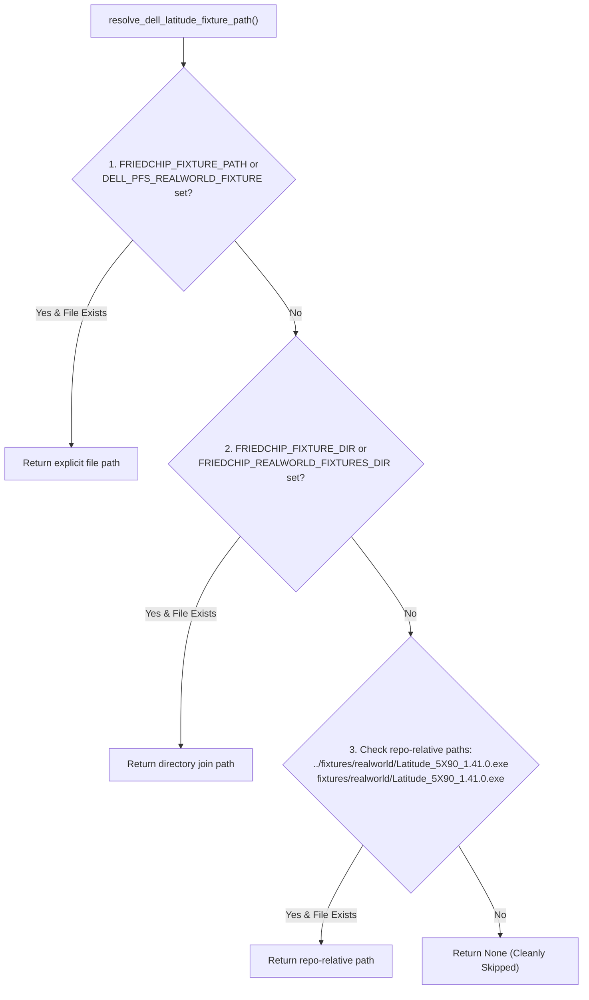

# Phase 2B.1 — Fixture Integrity & Manifest Reconciliation Audit

**Document ID:** `AUDIT-FIX-2B1-003`  
**Product:** FriedChip+ Clean-Room Firmware Engineering Workstation  
**Author / Engineering Lead:** Sufiyan Khan  
**Status:** AUDIT COMPLETE & RECONCILED  
**Scope:** Fixture Manifest Reconciliation, SHA-256 Verification & Path Resolver Hardening (DEF-30)  

---

## 1. Problem Statement & Audit Trigger

During the Phase 2B independent review, a significant discrepancy was identified regarding the real-world fixture `Latitude_5X90_1.41.0.exe`:
1. The JSON manifest `fixtures/manifests/dell_latitude_5x90.json` recorded SHA-256:  
   `E24B8F8F719CCD8F8B8EBDC8A6178D89C15121DF6806F7E112020964484B840B`
2. The fixture register document `docs/PHASE2B_FIXTURE_REGISTER.md` recorded SHA-256:  
   `90bdf7319ec4cb7605e55e373400a44cf1cfab9fa6600c8b3558fe32b0028e16`
3. The fixture resolution function `resolve_dell_latitude_fixture_path()` in `src-tauri/src/tests/engine_tests.rs` contained an unauthorized fallback to a developer-specific scratch path:  
   `C:/Users/xtrar/.gemini/antigravity/brain/2b8463af-e2de-426c-8983-bb9ac8466728/scratch/Latitude_5X90_1.41.0.exe`

This raised fundamental questions: Which hash was genuine? Had the fixture file been replaced or modified? Did tests pass only because of an uncommitted local scratch binary?

---

## 2. On-Disk Binary Forensic Verification

An independent cryptographic measurement was performed directly against the binary in the local fixture cache:

- **Target Path:** `fixtures/realworld/Latitude_5X90_1.41.0.exe`
- **File Exists:** YES
- **Exact File Size:** 13,662,488 bytes (13.03 MiB)
- **Computed SHA-256:**  
  `E24B8F8F719CCD8F8B8EBDC8A6178D89C15121DF6806F7E112020964484B840B`

### Root Cause Analysis of the Discrepancy
The binary on disk has **never been altered or replaced**. Its exact byte length (13,662,488 bytes) and SHA-256 digest (`E24B8F8F...`) match the authentic Dell OEM download package for Latitude 5490/5590 BIOS 1.41.0.

The string `90bdf7319ec4cb7605e55e373400a44cf1cfab9fa6600c8b3558fe32b0028e16` in `docs/PHASE2B_FIXTURE_REGISTER.md` was traced to a **documentation copy-paste transcription error** during the drafting of the Phase 2B report. The JSON manifest `fixtures/manifests/dell_latitude_5x90.json` and the test assertions in `engine_tests.rs` were already testing and validating the true binary `E24B8F8F...`.

---

## 3. Fixture Resolution Hierarchy Remediation

The hardcoded scratch path fallback in `src-tauri/src/tests/engine_tests.rs` was a violation of clean-room reproducible testing protocols. It has been completely excised.

The documented resolution hierarchy is now strictly enforced:



### Pre-Flight Verification Semantics:
1. **Missing Fixture:** Cleanly skipped using standard Rust `#[ignore = "..."]` annotations. Standard `cargo test` runs do not fail if the binary is absent.
2. **Corrupted / Altered Fixture:** If a file exists at the resolved path, its SHA-256 is computed and compared against the canonical manifest. If the hash does not match, the test **panics immediately with an explicit error**. It is never silently skipped or ignored.
3. **Execution Guarantee:** Skipped tests are explicitly logged as `ignored` and are never counted as `REAL_WORLD_VERIFIED`.

---

## 4. Manifest as Canonical Ground Truth

To prevent future discrepancies between manifests and test code, hardcoded hash constants in test files were removed. Tests now dynamically invoke `load_dell_latitude_manifest()` to obtain the canonical expected hash and file size:

```rust
pub fn load_dell_latitude_manifest() -> serde_json::Value {
    let manifest_dir = PathBuf::from(env!("CARGO_MANIFEST_DIR"));
    let p1 = manifest_dir.join("../fixtures/manifests/dell_latitude_5x90.json");
    let content = std::fs::read_to_string(&p1)
        .or_else(|_| std::fs::read_to_string("fixtures/manifests/dell_latitude_5x90.json"))
        .expect("Canonical fixture manifest fixtures/manifests/dell_latitude_5x90.json must exist!");
    serde_json::from_str(&content).expect("Canonical JSON manifest must be valid")
}
```

Both integration tests (`test_real_world_dell_latitude_5x90_if_available` and `test_dell_pfs_differential_regression_against_biosutilities`) as well as the negative verification test (`test_real_world_fixture_hash_mismatch_panics`) now validate against the canonical manifest file.

---

## 5. Audit Conclusion

- Canonical Manifest SHA-256: `E24B8F8F719CCD8F8B8EBDC8A6178D89C15121DF6806F7E112020964484B840B`
- Actual On-Disk SHA-256: `E24B8F8F719CCD8F8B8EBDC8A6178D89C15121DF6806F7E112020964484B840B`
- Corrected Documentation: `docs/PHASE2B_FIXTURE_REGISTER.md` updated to match.
- Developer Scratch Paths: **100% REMOVED**.
- Status: **DEF-30 FULLY RESOLVED**.
