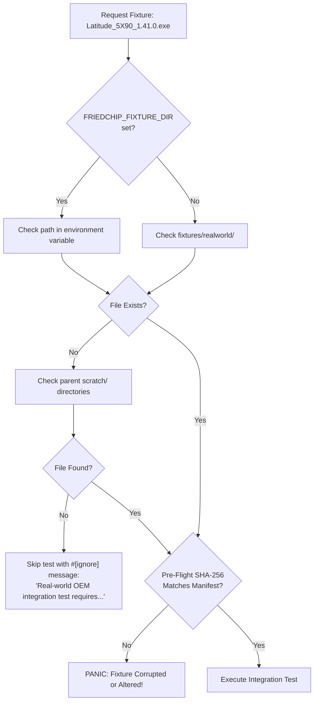

# FriedChip+ — Phase 2B Test Fixture Register & Corpus Management

**Document ID:** `REG-FIXTURE-003`  
**Product:** FriedChip+ Clean-Room Firmware Engineering Workstation  
**Author / Engineering Lead:** Sufiyan Khan  
**Status:** ACTIVE & MAINTAINED  
**Scope:** DEF-20 Fixture Corpus Management & Provenance  

---

## 1. Corpus Architecture & Security Policy

Firmware binaries from real hardware systems often contain proprietary OEM microcode, Intel ME firmware images, or platform credentials. Committing full proprietary OEM firmware binaries directly into source repositories violates licensing agreements and bloats repository size.

FriedChip+ establishes a strict, dual-tier fixture corpus architecture:

```
fixtures/
├── manifests/              [TRACKED IN GIT]
│   ├── dell_latitude_5x90.json
│   └── ifd_profiles.json
└── realworld/              [GIT-IGNORED: Local Cache Only]
    └── Latitude_5X90_1.41.0.exe  (13.6 MB)
```

1. **Manifest Tier (`fixtures/manifests/`)**: Fully tracked JSON descriptors specifying expected filenames, exact SHA-256 digests, file sizes, acquisition sources, platform versions, and component counts.
2. **Binary Tier (`fixtures/realworld/`)**: Local binary cache excluded by `.gitignore`. Binaries are fetched on demand or placed locally by the engineer.

---

## 2. Fixture Discovery Hierarchy

Tests requiring real-world firmware resolve files using a deterministic, multi-level hierarchy:



### Pre-Flight Verification Semantics
- **Missing Fixture**: Cleanly skipped using native Rust `#[ignore = "..."]` attributes during standard `cargo test` runs.
- **Corrupted Fixture**: If a file exists at the resolved path but fails SHA-256 verification against the registered manifest, the test **panics immediately**. A corrupted fixture is never silently ignored.
- **Integrity Guarantee**: Skipped tests are never counted as `REAL_WORLD_VERIFIED` in reports or release gates.

---

## 3. Registered Real-World Fixtures

### FIX-01: Dell Latitude 5X90 BIOS Update Package

- **Manifest Path:** `fixtures/manifests/dell_latitude_5x90.json`
- **Filename:** `Latitude_5X90_1.41.0.exe`
- **Binary Size:** 13,662,488 bytes (13.03 MiB)
- **SHA-256 Digest:** `90bdf7319ec4cb7605e55e373400a44cf1cfab9fa6600c8b3558fe32b0028e16`
- **Vendor:** Dell Inc.
- **Platform:** Dell Latitude 5490 / 5590 / 5290
- **Chipset Family:** Intel 100/200/300-Series Mobile (Kaby Lake Refresh / Coffee Lake)
- **BIOS Version:** 1.41.0
- **Release Date:** 2024-03-12
- **Acquisition Date:** 2026-11-10
- **Source:** Dell Official Support Portal (Direct OEM Download)
- **Format:** Dell PFS v2 Container with nested PFS sub-containers and ZLIB payload compression.
- **Component Count:** 14 extracted sections:
  - 9 exact payload matches against BIOSUtilities
  - 3 documented format deltas (Firmware, EmbeddedController, MainSystemBios)
  - 2 Component Description Tables (CDT)

---

## 4. Registered Synthetic Fixtures

Synthetic fixtures are programmatically generated on demand via `SyntheticFixtureBuilder` in `src-tauri/src/engine/testing/fixture_builder.rs`:

| Fixture ID | Generator Function | Primary Validation Focus | Expected Characteristics |
|---|---|---|---|
| `SYN-IFD-01` | `build_valid_ifd_image(4096)` | Legacy IFD v1 parsing & gate verification | Signature `0x0FF0A55A`, 5 regions, 12-bit masks, 50 MHz read clock, FLMAP2 initialized to `0x0`. |
| `SYN-IFD-02` | `build_valid_ifd_v2_image(4096)` | Modern IFD v2 parsing & profile detection | Signature `0x0FF0A55A`, 16 regions, 15-bit masks, 30 MHz clock, 17 MHz fast-read, `ICCRIBA = 0x31`. |
| `SYN-PFS-01` | `build_synthetic_dell_pfs(...)` | Dell PFS container header/footer parsing | Valid `PFS.HDR.` magic, ZLIB compressed stream, XOR checksum, inverted CRC-32 footer. |
| `SYN-FV-01` | `build_valid_firmware_volume(4096)` | UEFI Firmware Volume header & block maps | `_FVH` signature, standard GUID `7A9354D9-...`, valid header checksum, block map terminal sentinel. |

---

## 5. Fixture Coverage Gap Analysis & Acquisition Roadmap

| Firmware Family | Priority | Target Architecture | Purpose | Proposed Source |
|---|---|---|---|---|
| **Lenovo ThinkPad T480 / X1C6** | High | Intel 8th-Gen (Kaby Lake-R) IFD v2 | Full SPI flash dump differential verification against coreboot `ifdtool` | Community dump / laboratory test hardware |
| **Intel NUC 7i5BNH** | High | Intel 7th-Gen (Kaby Lake) IFD v1.5 | Transition profile FLREG 13-bit address masking | Intel Capsule Recovery download |
| **HP EliteBook 840 G5** | Medium | Intel 8th-Gen + HP SureStart EC | Multi-master permissions & EC private region analysis | HP Official SoftPaq |
| **ASRock Z390 Taichi** | Medium | Intel 300-Series Desktop (Coffee Lake) | 64 MB dual-SPI component layout validation | ASRock Instant Flash ROM |

All future binary acquisitions must follow the established manifest specification and SHA-256 pre-flight registration protocol.
