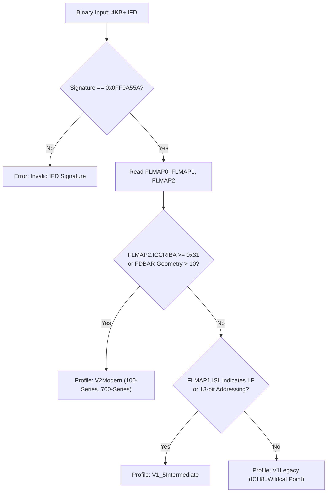

# FriedChip+ — Intel Flash Descriptor Profile Specification

**Document ID:** `SPEC-IFD-001`  
**Product:** FriedChip+ Clean-Room Firmware Engineering Workstation  
**Author / Engineering Lead:** Sufiyan Khan  
**Status:** APPROVED FOR PHASE 2B  
**Upstream Research References:**
- `coreboot/coreboot`: `util/ifdtool/ifdtool.h`, `ifdtool.c` (commit `66e704b1`, GPL-2.0)
- `flashrom/flashrom`: `ich_descriptors.c`, `include/ich_descriptors.h` (commit `35c679c`, GPL-2.0)
- Intel 6-Series, 100-Series, 300-Series, and 500-Series SPI Programming Guides

---

## 1. Overview & Architectural Motivation

The Intel Flash Descriptor (IFD) is a foundational 4 KB data block located at the base of the SPI flash (LBA 0). It governs hardware strapping, region partition boundaries, master read/write access controls, and SPI clock configurations for Intel Platform Controller Hub (PCH) and legacy I/O Controller Hub (ICH) chipsets.

Prior naive or ad-hoc descriptor implementations assumed uniform bitfields across all Intel platforms, or relied on heuristic region counts (`nr >= 10`). As demonstrated by empirical inspection of `coreboot` and `flashrom`, Intel altered bit widths, address masks, clock frequency tables, and master register bitfields between ICH8 (2006) and contemporary Core/Xeon chipsets (2024+).

FriedChip+ establishes a formal, evidence-backed profile taxonomy (`IfdProfile`) ensuring correct hardware parsing across all generations without unsafe generalizations.

---

## 2. Profile Taxonomy

```
+-----------------------------------------------------------------------------------------+
|                                    IfdProfile                                           |
+--------------------------+------------------------------+-------------------------------+
|       V1Legacy           |      V1_5Intermediate        |           V2Modern            |
+--------------------------+------------------------------+-------------------------------+
| ICH8, ICH9, ICH10        | Lynx Point-LP (Mobile Haswell)| Skylake (100-Series)         |
| Ibex Peak (5-Series)     | Wellsburg (C610 Series)      | Kaby Lake (200-Series)        |
| Cougar Point (6-Series)  | Wildcat Point-LP (Broadwell) | Coffee Lake (300-Series)      |
| Panther Point (7-Series) |                              | Comet Lake (400-Series)       |
| Lynx Point (8-Series)    |                              | Tiger / Rocket Lake (500-Ser) |
| Wildcat Point (9-Series) |                              | Alder / Raptor Lake (600/700) |
| Bay Trail, Braswell      |                              | Meteor Lake, Arrow Lake       |
+--------------------------+------------------------------+-------------------------------+
```

### 2.1 Profile Definitions

1. **`IfdProfile::V1Legacy`**:
   - Covers Intel ICH8 through Wildcat Point (9-Series) and Bay Trail.
   - Characterized by 12-bit FLREG address masks (`0x0FFF`), 3-bit component densities, 50 MHz clock on bitfield 4, and master write permissions shifted by 24 bits.
   - Maximum region count is explicitly signaled by `FLMAP0[26:24]` (`NR`).

2. **`IfdProfile::V1_5Intermediate`**:
   - Covers low-power Haswell/Broadwell (Lynx Point-LP / Wildcat Point-LP) and Wellsburg C610 platforms.
   - Characterized by 13-bit FLREG address masks (`0x1FFF`), intermediate strap offsets, and transition clock tables.

3. **`IfdProfile::V2Modern`**:
   - Covers 100-Series (Sunrise Point / Skylake) through contemporary 700-Series and Meteor Lake platforms.
   - Characterized by 15-bit FLREG address masks (`0x7FFF`), 4-bit component densities (up to 64 MB per component), 30 MHz clock on bitfield 4, 17 MHz clock on bitfield 6, master write permissions shifted by 20 bits, and up to 16 region entries.
   - `NR` in `FLMAP0` is officially deprecated/dropped by Intel; region counts are bounded by descriptor table offsets (`FRBA` spacing).

4. **`IfdProfile::Unknown`**:
   - Fallback profile assigned when descriptor headers fail conservative structural invariants.
   - Enables safe degradation without panics or corrupt memory reads.

---

## 3. Register Specification & Bitfield Layouts

### 3.1 Descriptor Header & Flash Map Registers

The Flash Descriptor begins at offset `0x0000` with the Flash Descriptor Header (FDH).

| Offset | Register Name | Description |
|---|---|---|
| `0x00..0x0F` | Reserved / Preamble | Unused header space |
| `0x10..0x13` | `FLVALSIG` | Flash Valid Signature: must equal `0x0FF0A55A` |
| `0x14..0x17` | `FLMAP0` | Flash Map 0: Component & Region base addresses and counts |
| `0x18..0x1B` | `FLMAP1` | Flash Map 1: Master base address & strap configurations |
| `0x1C..0x1F` | `FLMAP2` | Flash Map 2: Secondary strap & ICC registers |

#### FLMAP0 Register Layout

```
 31      27 26    24 23              16 15      10 9    8 7                0
+----------+--------+------------------+----------+------+------------------+
| Reserved |   NR   |       FRBA       | Reserved |  NC  |       FCBA       |
+----------+--------+------------------+----------+------+------------------+
```

- **`FCBA` (bits 7:0)**: Flash Component Base Address. Shifted left by 4 (`FCBA << 4`) to yield byte offset in descriptor (typically `0x0030` or `0x0040`).
- **`NC` (bits 9:8)**: Number of Components minus 1 (`0` = 1 component, `1` = 2 components).
- **`FRBA` (bits 23:16)**: Flash Region Base Address. Shifted left by 4 (`FRBA << 4`) to yield byte offset in descriptor (typically `0x0040` or `0x0060`).
- **`NR` (bits 26:24)**:
  - *V1Legacy*: Number of Flash Regions minus 1 (supports up to 5 or 8 regions).
  - *V2Modern*: Dropped by Intel. Unused/reserved. Region count is derived from geometry between `FRBA` and successor tables (up to 16 regions).

#### FLMAP1 Register Layout

```
 31              24 23              16 15      11 10    8 7                0
+------------------+------------------+----------+------+------------------+
|       ISL        |      FPSBA       | Reserved |  NM  |       FMBA       |
+------------------+------------------+----------+------+------------------+
```

- **`FMBA` (bits 7:0)**: Flash Master Base Address. Shifted left by 4 (`FMBA << 4`) to yield byte offset.
- **`NM` (bits 10:8)**: Number of Masters minus 1.
- **`FPSBA` / `FISBA` (bits 23:16)**: Flash PCH / ICH Strap Base Address.
- **`ISL` (bits 31:24)**: ICH / PCH Strap Length in DWORDs.

#### FLMAP2 Register Layout

```
 31              24 23              16 15               8 7                0
+------------------+------------------+------------------+------------------+
|     Reserved     |     ICCRIBA      |      MSL/CPUSL   |     FMSBA/CPURBA |
+------------------+------------------+------------------+------------------+
```

- **`FMSBA` / `CPURBA` (bits 7:0)**: Flash Master Strap Base Address / CPU Strap Base Address.
- **`MSL` (bits 15:8)**: Master Strap Length.
- **`ICCRIBA` (bits 23:16)**: Integrated Clock Controller Register Init Base Address. When present, indicates Cougar Point (6-Series) or later.

---

## 4. Flash Regions Table (`FLREG0`..`FLREG15`)

Flash Regions are defined by consecutive 32-bit registers located starting at `FRBA << 4`.

```
 31              16 15                                 0
+------------------+------------------------------------+
|   Region Limit   |            Region Base             |
|   (Block Pages)  |           (Block Pages)            |
+------------------+------------------------------------+
```

### 4.1 Address Translation & Page Masking

Each region register encodes a base page and limit page in 4 KB blocks:

$$\text{Base Address} = (\text{raw\_val} \ \& \ \text{Base Mask}) \ll 12$$

$$\text{Limit Address} = (((\text{raw\_val} \gg 16) \ \& \ \text{Limit Mask}) \ll 12) \ | \ \text{0x0FFF}$$

$$\text{Size} = (\text{Limit Address} + 1) - \text{Base Address}$$

| Profile | Base Bitmask | Limit Bitmask | Max Addressable Space |
|---|---|---|---|
| `V1Legacy` | `0x0FFF` (12 bits) | `0x0FFF` (12 bits) | 16 MB (`0x00FFFFFF`) |
| `V1_5Intermediate` | `0x1FFF` (13 bits) | `0x1FFF` (13 bits) | 32 MB (`0x01FFFFFF`) |
| `V2Modern` | `0x7FFF` (15 bits) | `0x7FFF` (15 bits) | 128 MB (`0x07FFFFFF`) |

### 4.2 Region Status & Disabled Detection

In accordance with Intel SPI Controller hardware behavior:
- A region is **DISABLED / UNUSED** if and only if:
  $$\text{limit\_raw} < \text{base\_raw}$$
- Typical disabled sentinel: `0x00007FFF` (Base = `0x7FFF`, Limit = `0x0000`) or `0x00001FFF`.
- **Region 0 (Flash Descriptor)** is encoded as `0x00000000` (Base = `0x0000`, Limit = `0x0000`). Because $0 \nless 0$, this represents an **ACTIVE** 4 KB region covering `0x00000000..0x00000FFF`.

### 4.3 Standard Region Assignments

| Region Index | Name | Description | Supported In |
|---|---|---|---|
| 0 | Descriptor | Intel Flash Descriptor Header & Configuration | All |
| 1 | BIOS | Host CPU UEFI/BIOS firmware and Firmware Volumes | All |
| 2 | ME | Intel Management Engine / Converged Security Engine | All |
| 3 | GbE | Gigabit Ethernet non-volatile MAC/PHY configuration | All |
| 4 | Platform Data | Platform Data Region (PDR) | All |
| 5 | Device Expansion | Device Expansion Region 1 | 8-Series+ |
| 6 | Secondary BIOS | Redundant / Secondary BIOS image | 9-Series+ |
| 7 | Microcode | Dedicated CPU Microcode update cache | 100-Series+ |
| 8 | EC | Embedded Controller firmware partition | 100-Series+ |
| 9 | Device Expansion 2 | Device Expansion Region 2 | 100-Series+ |
| 10 | IE | Innovation Engine firmware | 100-Series Server |
| 11 | 10GbE | 10-Gigabit Ethernet configuration | 100-Series Server |
| 12 | Oprom | Dedicated Option ROM storage | 300-Series+ |
| 13 | Reserved / PFR | Intel Platform Firmware Resilience (PFR) log | 400-Series+ |
| 14 | Reserved | Intel internal security region | 500-Series+ |
| 15 | Reserved | Intel internal debug region | 500-Series+ |

---

## 5. Flash Component Register (`FLCOMP`)

The `FLCOMP` register defines SPI flash hardware parameters (density, fast-read support, read frequencies, and write frequencies). It is located at `FCBA << 4`.

```
 31            24 23     21 20     17 16 15 14 13 12     8 7     4 3     0
+----------------+---------+---------+-----+-----+--+-----+-------+-------+
|    Reserved    | Wr Freq | Rd Freq | FSt | Res |FR| Res | Comp2 | Comp1 |
+----------------+---------+---------+-----+-----+--+-----+-------+-------+
```

### 5.1 Component Density Encoding

- In `V1Legacy`:
  - `Comp1 Density`: bits `[2:0]` (3 bits)
  - `Comp2 Density`: bits `[5:3]` (3 bits)
- In `V2Modern`:
  - `Comp1 Density`: bits `[3:0]` (4 bits)
  - `Comp2 Density`: bits `[7:4]` (4 bits)

#### Density Lookup Table

| Value (Bits) | V1Legacy Density | V2Modern Density |
|---|---|---|
| `0b0000` (0) | 512 KB | 512 KB |
| `0b0001` (1) | 1 MB | 1 MB |
| `0b0010` (2) | 2 MB | 2 MB |
| `0b0011` (3) | 4 MB | 4 MB |
| `0b0100` (4) | 8 MB | 8 MB |
| `0b0101` (5) | 16 MB | 16 MB |
| `0b0110` (6) | Reserved | 32 MB |
| `0b0111` (7) | Reserved | 64 MB |
| `0b1111` (15)| N/A | Component Not Present |

### 5.2 SPI Clock Frequency Encodings

Intel altered SPI frequency encodings across controller generations. Defaulting reserved or unknown values to 20 MHz is forbidden in FriedChip+; all encodings must be strictly classified:

```rust
#[derive(Debug, Clone, Copy, PartialEq, Eq, Serialize, Deserialize)]
pub enum SpiFrequency {
    Mhz(u32),
    Reserved(u8),
    RepurposedEspi(u8),
}
```

| Bit Value | `V1Legacy` / `V1_5Intermediate` | `V2Modern` (100-Series..700-Series) |
|---|---|---|
| `0b000` (0) | 20 MHz | 20 MHz |
| `0b001` (1) | 33 MHz | 33 MHz |
| `0b010` (2) | 48 MHz | 48 MHz |
| `0b011` (3) | Reserved | Reserved |
| `0b100` (4) | **50 MHz** | **30 MHz** |
| `0b101` (5) | Reserved | Reserved |
| `0b110` (6) | Reserved | **17 MHz** |
| `0b111` (7) | Reserved | Reserved |

---

## 6. Flash Master Permissions (`FLMSTR1`..`FLMSTR5`)

Located at `FMBA << 4`, each `FLMSTRn` register defines read and write access rules for a hardware bus master.

- `FLMSTR1`: Host CPU / BIOS master
- `FLMSTR2`: Management Engine (ME) / Converged Security Engine (CSE)
- `FLMSTR3`: Integrated Gigabit Ethernet (GbE)
- `FLMSTR4`: Innovation Engine (IE) / Platform Controller
- `FLMSTR5`: Embedded Controller (EC)

### 6.1 Bitfield Layouts Across Profiles

#### V1Legacy FLMSTR Format

```
 31            24 23            16 15                            0
+----------------+----------------+-------------------------------+
|   Write Mask   |   Read Mask    |         Requester ID          |
|  (Regions 7:0) |  (Regions 7:0) |          (Bus/Dev/Fn)         |
+----------------+----------------+-------------------------------+
```
- **Write Shift**: 24 bits (`(val >> 24) & 0xFF`)
- **Read Shift**: 16 bits (`(val >> 16) & 0xFF`)

#### V2Modern FLMSTR Format

```
 31            20 19    16 15            4 3            0
+----------------+--------+---------------+--------------+
|   Write Mask   | Res/Ext|   Read Mask   | Res/Ext Regs |
| (Regions 11:0) |        | (Regions 11:0)|              |
+----------------+--------+---------------+--------------+
```
- **Write Shift**: 20 bits (`(val >> 20) & 0x0FFF`)
- **Read Shift**: 8 bits (`(val >> 8) & 0x0FFF` or bits `15:4`)

### 6.2 Host Permission Separation & Runtime Locks

In previous firmware analysis utilities, host descriptor permissions were frequently conflated with runtime SPI flash write locks. FriedChip+ strictly separates them:

1. **`host_descriptor_bios_write_allowed`**:
   - Represents the static descriptor permission bit in `FLMSTR1`.
   - Set to `true` if `(flmstr1_write_mask & (1 << REGION_BIOS)) != 0`.
2. **`RuntimeChipsetLockStatus`**:
   - Classifies runtime register status (`PR0`..`PR4`, `SMM_BWP`, `BLE`).
   - Because a static SPI dump contains only flash descriptor bytes and cannot inspect live PCI configuration space, FriedChip+ mandates:
   ```rust
   pub runtime_chipset_lock_status: RuntimeChipsetLockStatus::Indeterminate
   ```
   Positive claims of "chipset unlocked" without live hardware telemetry are strictly rejected.

---

## 7. Profile Detection Algorithm

FriedChip+ uses an evidence-backed detection procedure that evaluates multiple physical indicators before assigning a profile:



1. **Signature Sanity**: Verifies `FLVALSIG == 0x0FF0A55A` at offset `0x10`.
2. **Table Boundary Invariants**: Asserts that `FCBA`, `FRBA`, and `FMBA` are non-zero, within descriptor boundaries (`< 4096`), and do not collide.
3. **ICC & Strap Inspection**: `ICCRIBA >= 0x31` in `FLMAP2` definitively marks modern Skylake+ architectures.
4. **Strap Length Inspection**: Modern PCH descriptors feature extended strap lengths (`ISL > 16 DWORDs`).
5. **Fallback Safety**: If profile indicators conflict, `IfdProfile::Unknown` is assigned, triggering conservative bounds checking.
