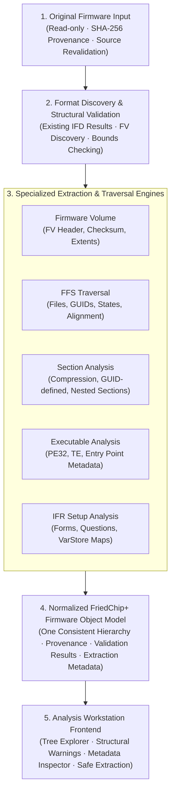

# Phase 3A · UEFI Structure Analysis Architecture

**Project:** FriedChip+ Clean-Room Firmware Engineering Workstation  
**Domain:** System Architecture, Pipeline Data Flow & Normalized Object Model  
**Milestone:** Phase 3A (Upstream Component Intelligence & Architecture Design)  
**Author / Engineering Lead:** Sufiyan Khan  
**Status:** COMPLETE ARCHITECTURE DESIGN DELIVERABLE  
**Scope Restriction:** Architecture & Specification Only. Zero code changes in application source tree.

---

## 1. High-Level Architectural Pipeline

The FriedChip+ UEFI Analysis Subsystem implements an end-to-end, multi-stage pipeline designed for memory safety, cryptographic provenance, strict bounded execution, and non-destructive firmware inspection on Windows:



---

## 2. Eleven-Layer Architectural Decomposition

Following clean-room software engineering principles, the subsystem is organized into 11 strictly bounded layers:

### Layer 1: Input & Provenance Layer
- **Read-Only Encasement:** Source files are opened with shared read locks (`FILE_SHARE_READ`) and immediately revalidated against their initial database SHA-256 hash.
- **Source Immutability:** No write handles are ever requested on source files. Original binary streams are strictly treated as immutable byte slices (`&[u8]`).

### Layer 2: Firmware Image Identification Layer
- **Format Discovery:** Integrates existing Phase 2 Intel Flash Descriptor (IFD) results to locate the BIOS region (`RegionType::Bios`).
- **Autonomous FV Scanning:** If an IFD is absent or corrupted, the discovery engine scans for Firmware Volume signatures (`_FVH` at offset `+0x28`) on 4KB or 64KB alignment boundaries across the binary.
- **Physical Extent Bounds:** Discovered volume boundaries are validated against the total container size before passing to downstream parsers.

### Layer 3: Structural Traversal Engine
- **Recursive Volume Walker:** Decouples physical byte traversal from semantic interpretation.
- **Nesting Containment:** Enforces a maximum recursion depth of 16 levels to prevent stack overflow on recursive nested encapsulation sections.
- **Cycle Detection:** Maintains a visited offset set to detect cyclical or self-referential nested volumes.

### Layer 4: Format-Specific Parser Adapters
- **Modular Driver Architecture:** Each format is handled by a specialized adapter conforming to a unified trait (`FirmwareParserAdapter`).
- **Plug-in Backends:**
  * Native Rust Engine (fast in-process analysis for standard FV/FFS).
  * `UEFIExtract` Subprocess Adapter (isolated C++ worker for complex vendor quirks and bulk physical file extraction).
  * `utk` Subprocess Adapter (Go-based JSON verification oracle).

### Layer 5: Decompression Service
- **Bounded Buffer Decompression:** Supports EFI 1.1, Tiano, LZMA, and Brotli.
- **Decompression Bomb Protection:**
  * Maximum unpacked size per section strictly capped at 128 MB.
  * Maximum expansion ratio strictly capped at 50:1.
  * Allocation is pre-checked against available system memory before decompression begins.
- **Corrupt Stream Safety:** Returns typed error `AppError::DecompressionFailure` on invalid Huffman tables or out-of-bounds LZ references without panicking.

### Layer 6: PE32 / TE Executable Inspection
- **Non-Executing Header Validation:** Parses PE32/PE32+ and Terse Executable (TE) headers.
- **Metadata Extraction:** Extracts Subsystem (`EFI_BOOT_SERVICE_DRIVER`, `EFI_RUNTIME_DRIVER`), Machine Architecture (x86, x64, ARM64), Entry Point RVA, and Section Tables (`.text`, `.data`).
- **TE Stripped Offset Alignment:** Reconstructs the stripped DOS/COFF headers mathematically to compute correct in-memory and in-flash offsets.

### Layer 7: IFR Setup Analysis Layer
- **HII Package Extraction:** Locates `EFI_SECTION_FREEFORM` or `EFI_SECTION_RAW` holding HII Package Lists.
- **Bytecode Disassembly:** Decodes IFR opcodes into a typed Abstract Syntax Tree (FormSets, Forms, Questions, Options, Defaults, Expressions).
- **VarStore Mapping:** Correlates question IDs with NVRAM `VarStoreId` and `VarOffset` to expose exact non-volatile variable offsets.
- **Zero-Modification Policy:** Strictly read-only setup browser. Automated write-back or NVRAM byte flipping is explicitly excluded.

### Layer 8: Normalized Firmware Object Model (NFOM)
- **Unified Schema:** Represents every element in the firmware dump as a `FirmwareNode` in a single coherent tree hierarchy.
- **Preservation Guarantee:** Unrecognized or proprietary sections are never discarded; they are classified as `NodeType::Unknown` with raw byte boundaries preserved.

### Layer 9: Validation and Diagnostics Layer
- **In-Depth Checksum Verification:** Header checksums, data checksums, and block map alignments are evaluated.
- **Confidence Scoring:** Nodes receive a `ValidationStatus` (`Valid`, `Warning`, `Malformed`, `Unchecked`).
- **Diagnostic Issues:** Specific anomalies (e.g. truncated FFS file, invalid alignment padding, state mismatch) are attached as typed diagnostic items.

### Layer 10: Extraction and Artifact Management Layer
- **Atomic Disk Writer:** Decompressed payloads and extracted files are written using atomic temporary files with SHA-256 verification.
- **Workspace Isolation:** Extracted artifacts are stored in dedicated project workspace directories with collision protection.

### Layer 11: UI-Facing Analysis API
- **Tauri IPC Command Layer:** Exposes JSON-serialized tree models to the React 19 frontend.
- **Virtual Tree Navigation:** Supports lazy-loading and search filtering for large firmware trees containing thousands of FFS files.

---

## 3. Normalized FriedChip+ Firmware Object Model (NFOM)

The heart of the FriedChip+ architecture is the **Normalized Firmware Object Model**, providing a consistent, typed schema across all firmware vendors:

```rust
/// Unique identifier for every node in the firmware hierarchy.
pub type NodeId = usize;

/// High-level node classification.
#[derive(Debug, Clone, PartialEq, Eq, Serialize, Deserialize)]
pub enum NodeType {
    RootImage,
    BiosRegion,
    FirmwareVolume,
    FfsFile,
    Section,
    Pe32Executable,
    TeExecutable,
    IfrFormSet,
    NvramStore,
    UnknownBlob,
}

/// Normalized node representing an element in the firmware hierarchy.
#[derive(Debug, Clone, Serialize, Deserialize)]
pub struct FirmwareNode {
    /// Unique monotonically increasing node ID.
    pub id: NodeId,
    /// Parent node ID (None for RootImage).
    pub parent_id: Option<NodeId>,
    /// Child node IDs in structural order.
    pub children: Vec<NodeId>,
    /// Node classification.
    pub node_type: NodeType,
    /// Human-readable display label (e.g., "DXE Firmware Volume", "SmmLockBox", "PE32 Image").
    pub name: String,
    /// Absolute byte offset within the root firmware container.
    pub container_offset: usize,
    /// Declared size in header (bytes).
    pub declared_size: usize,
    /// Actual physical size occupied in container (including alignment padding).
    pub actual_size: usize,
    /// 16-byte GUID (for FVs, FFS files, GUID-defined sections).
    pub guid: Option<String>,
    /// Human-readable GUID name from database (e.g., "Tcg2Dxe").
    pub guid_name: Option<String>,
    /// SHA-256 of node's raw payload.
    pub payload_sha256: String,
    /// Validation and diagnostic results.
    pub validation: NodeValidation,
    /// Specific typed metadata payload based on node_type.
    pub metadata: NodeSpecificMetadata,
}

/// Validation result attached to each node.
#[derive(Debug, Clone, Serialize, Deserialize)]
pub struct NodeValidation {
    pub is_valid: bool,
    pub status: ValidationStatus,
    pub warnings: Vec<String>,
    pub errors: Vec<String>,
}

#[derive(Debug, Clone, PartialEq, Eq, Serialize, Deserialize)]
pub enum ValidationStatus {
    Valid,
    Warning,
    Malformed,
    Unchecked,
}

/// Specialized metadata variants.
#[derive(Debug, Clone, Serialize, Deserialize)]
pub enum NodeSpecificMetadata {
    FirmwareVolume(FvMetadata),
    FfsFile(FfsMetadata),
    Section(SectionMetadata),
    Executable(ExecutableMetadata),
    Ifr(IfrMetadata),
    Unknown(UnknownMetadata),
}

#[derive(Debug, Clone, Serialize, Deserialize)]
pub struct FvMetadata {
    pub file_system_guid: String,
    pub header_length: u16,
    pub attributes: u32,
    pub block_map: Vec<FvBlockMapEntry>,
    pub checksum_valid: bool,
    pub erased_byte: u8,
}

#[derive(Debug, Clone, Serialize, Deserialize)]
pub struct FvBlockMapEntry {
    pub num_blocks: u32,
    pub block_length: u32,
}

#[derive(Debug, Clone, Serialize, Deserialize)]
pub struct FfsMetadata {
    pub file_type: u8,
    pub file_type_name: String,
    pub attributes: u8,
    pub state: u8,
    pub state_name: String,
    pub header_checksum_valid: bool,
    pub data_checksum_valid: Option<bool>,
    pub is_extended_size: bool,
}

#[derive(Debug, Clone, Serialize, Deserialize)]
pub struct SectionMetadata {
    pub section_type: u8,
    pub section_type_name: String,
    pub is_compressed: bool,
    pub compression_type: Option<String>,
    pub uncompressed_size: Option<usize>,
    pub is_extended_size: bool,
}

#[derive(Debug, Clone, Serialize, Deserialize)]
pub struct ExecutableMetadata {
    pub machine_type: u16,
    pub machine_name: String,
    pub subsystem: u16,
    pub subsystem_name: String,
    pub entry_point_rva: u32,
    pub image_base: u64,
    pub num_sections: usize,
    pub is_te: bool,
}

#[derive(Debug, Clone, Serialize, Deserialize)]
pub struct IfrMetadata {
    pub formset_guid: String,
    pub formset_title: String,
    pub form_count: usize,
    pub question_count: usize,
    pub varstore_ids: Vec<u16>,
}

#[derive(Debug, Clone, Serialize, Deserialize)]
pub struct UnknownMetadata {
    pub raw_header_bytes: Vec<u8>,
    pub reason: String,
}
```

---

## 4. Decompression & Memory Safety Architecture

To guarantee total workstation stability against malicious or malformed firmware images, the decompression engine enforces rigorous resource bounds:

```text
Incoming Compressed Section
  │
  ├── Size Check: Declared uncompressed size <= 128 MB?
  │     ├── NO  ──> Reject (AppError::DecompressionBombExceeded)
  │     └── YES ──> Continue
  │
  ├── Ratio Check: (Declared uncompressed size / Compressed size) <= 50?
  │     ├── NO  ──> Reject (AppError::DecompressionRatioExceeded)
  │     └── YES ──> Continue
  │
  ├── Memory Budget: System free memory > 2x Unpacked buffer?
  │     ├── NO  ──> Reject (AppError::ResourceExhaustion)
  │     └── YES ──> Allocate Bounded Buffer
  │
  └── Bounded Streaming Decompression
        ├── Corrupt Stream / Out-of-Bounds LZ reference?
        │     └──> Clean Error Return (Zero Panic, Zero Buffer Overrun)
        └── Output Stream Verified & SHA-256 Hashed
```

---

## 5. Subprocess Adapter Boundary Architecture

When invoking external helper binaries (`UEFIExtract.exe` or `utk.exe`):
1. **Isolated Address Space:** Helper binaries are spawned as child processes using `std::process::Command`.
2. **Crash Containment:** Any fault, segmentation violation, or assertion failure in C++ or Go child processes is contained within the child process and does not terminate FriedChip+.
3. **Structured IPC:** Communication occurs via standardized CLI arguments, file descriptors, or JSON streams (`stdout`), strictly validated against JSON schema upon return.
4. **Execution Timeouts:** Subprocesses are monitored with explicit timeout deadlines (default: 30 seconds); hung processes are killed cleanly.

---
EOF
