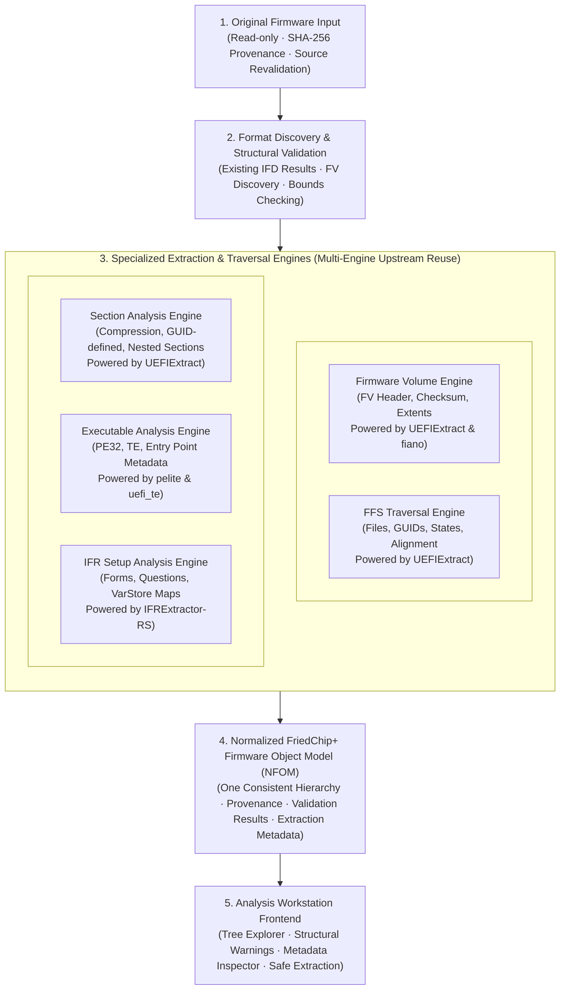

# Phase 3A.1 · UEFI Structure Analysis Architecture (Corrected)

**Project:** FriedChip+ Clean-Room Firmware Engineering Workstation  
**Domain:** System Architecture, Multi-Engine Pipeline & Normalized Object Model  
**Milestone:** Phase 3A.1 (Architecture Correction & Reuse-First Review)  
**Author / Engineering Lead:** Sufiyan Khan  
**Status:** COMPLETE ARCHITECTURE DESIGN DELIVERABLE  
**Scope Restriction:** Architecture & Specification Only. Zero code changes in application source tree.

---

## 1. High-Level Architectural Pipeline

The FriedChip+ UEFI Analysis Subsystem implements a reuse-first, multi-engine pipeline. Upstream tools provide battle-tested parsing and extraction; FriedChip+ provides process isolation, structural validation, unified normalization, and workstation UI exploration:



---

## 2. Multi-Engine Architectural Decomposition

FriedChip+ does not reinvent the firmware parser ecosystem. It coordinates specialized upstream engines within strict OS security and process containment boundaries:

### Stage 1: Input & Provenance Management
* **Read-Only Access:** Files are opened with Windows `FILE_SHARE_READ` locks.
* **Cryptographic Verification:** Firmware inputs are hashed (`SHA-256`) immediately upon ingestion and revalidated before analysis to guarantee immutability.
* **Buffer Safety:** Raw firmware data is treated strictly as an immutable byte slice (`&[u8]`).

### Stage 2: Format Discovery & Structural Validation
* **IFD BIOS Region Handoff:** Reads output from the permanently frozen Phase 2 Intel Flash Descriptor (IFD) parser. When valid, analysis anchors to the BIOS region (`RegionType::Bios`).
* **Standalone / Non-IFD Discovery:** In standalone images (AMD, raw capsule payloads, coreboot), a signature scanner detects `_FVH` at byte offset `+0x28`.
* **Verification Gates (Candidate Scanning vs Discovery):**
  - FV candidate scanning can produce false positives (strings, binary sequences).
  - Candidates are promoted to verified Firmware Volumes only after validating:
    1. Signature `_FVH` at `offset + 0x28`.
    2. `HeaderLength >= 0x38` and within container bounds.
    3. Recognized `FileSystemGuid` (FFS2, FFS3, NVRAM).
    4. Block map terminates in `{0, 0}` and sum of blocks equals `FvLength`.
    5. Inverted 16-bit word checksum across `HeaderLength` equals zero.
    6. Extent containment: `offset + FvLength <= container_length`.
  - Nested volumes inside encapsulation sections (e.g. `EFI_SECTION_FIRMWARE_VOLUME_IMAGE` at offset `+0x04` or `+0x18`) are parsed recursively without requiring fixed 4KB/64KB alignment.

### Stage 3: Specialized Traversal & Parsing Engines (Upstream Integration)
* **Primary Analysis Backend (`LongSoft/UEFITool` `UEFIExtract`):**
  - Handles complete firmware volume traversal, FFS file states, GUID identification, alignment padding, and recursive section decompression (EFI 1.1, Tiano, LZMA, Brotli).
  - Executed inside a process-isolated Windows Job Object with memory and CPU bounds.
* **Structured Validation Backend (`linuxboot/fiano` `utk`):**
  - Executes `utk image.bin table --json` to generate an independent JSON tree.
  - Used for differential validation to verify volume counts and file GUID sequences against `UEFIExtract`.
* **Setup Disassembly Backend (`LongSoft/IFRExtractor-RS`):**
  - Decodes HII Package Lists into an Abstract Syntax Tree (FormSets, Forms, Questions, Options, Defaults, Expressions).
  - Correlates question IDs with NVRAM `VarStoreId` and relative `VarOffset` (strictly relative to variable store data; not physical flash offsets).
  - Strictly read-only; no NVRAM modification or write-back logic.
* **Executable Inspection Engine (`pelite` / `uefi_te`):**
  - Parses PE32/PE32+ and Terse Executable (TE) headers without code execution.
  - Reconstructs stripped TE offsets mathematically: `AdjustedOffset = StrippedSize - sizeof(EFI_TE_IMAGE_HEADER)`.

### Stage 4: Normalized FriedChip+ Firmware Object Model (NFOM)
* Integrates disparate outputs from `UEFIExtract`, `utk`, and `IFRExtractor-RS` into a single coherent tree hierarchy.
* Guarantees that unsupported or vendor-specific proprietary blobs are never discarded; they are classified as `NodeType::Unknown` with raw byte boundaries and metadata preserved.

### Stage 5: Workstation Frontend & Safe Extraction
* **Virtual Tree Navigation:** React 19 virtualized tree rendering thousands of nodes smoothly.
* **Metadata Inspector:** Displays header attributes, checksum results, GUID resolutions, and IFR question lists.
* **Atomic Extraction:** Writes extracted payloads to an isolated project workspace directory using atomic file creation with path traversal sanitization.

---

## 3. Subprocess Security & Containment Architecture

A critical architectural distinction is required between simple process execution and a true OS security sandbox:

```text
┌────────────────────────────────────────────────────────────────────────┐
│                        FriedChip+ Security Levels                      │
├──────────────────────────┬─────────────────────────────────────────────┤
│ 1. Separate Process      │ std::process::Command: Isolates host memory │
│                          │ from child crash, but NO resource limits,   │
│                          │ NO filesystem protection, NO network block. │
├──────────────────────────┼─────────────────────────────────────────────┤
│ 2. Fault Containment     │ Child process crash (SEGV, panic) caught by │
│                          │ exit code inspection. Host stays running.   │
├──────────────────────────┼─────────────────────────────────────────────┤
│ 3. Resource Containment  │ Windows Job Objects: Memory ceilings, CPU   │
│                          │ quotas, process tree termination on timeout.│
├──────────────────────────┼─────────────────────────────────────────────┤
│ 4. OS Security Sandbox   │ Restricted Tokens, AppContainer, ACLs, and  │
│                          │ network isolation. Child cannot access host │
│                          │ disk, credentials, or network interfaces.   │
└──────────────────────────┴─────────────────────────────────────────────┘
```

> [!WARNING]
> Spawning a subprocess via `std::process::Command` alone **does not** create a security sandbox. Untrusted firmware images could exploit vulnerabilities in C++ or Go upstream parsers to access the local filesystem or exhaust resources.

### Future Windows Security Requirements for Subprocess Workers:

1. **Windows Job Objects (`CreateJobObjectW`, `SetInformationJobObject`):**
   - `JOB_OBJECT_LIMIT_PROCESS_MEMORY`: Hard ceiling on memory per worker (e.g. 512 MB).
   - `JOB_OBJECT_LIMIT_JOB_MEMORY`: Hard aggregate memory ceiling across all worker threads.
   - `JOB_OBJECT_LIMIT_JOB_TIME`: CPU execution time quota.
   - `JOB_OBJECT_LIMIT_KILL_ON_JOB_CLOSE`: Automatically destroys the worker process tree if FriedChip+ terminates unexpectedly.
   - `JOB_OBJECT_LIMIT_ACTIVE_PROCESS`: Prevents fork bombs by capping active process count to 1.
2. **Restricted Tokens (`CreateRestrictedToken`):**
   - Strips administrative and debugging privileges (`SeDebugPrivilege`, etc.).
   - Disables all non-essential security identifiers (SIDs).
3. **AppContainer Isolation Feasibility:**
   - Evaluates Windows AppContainer sandboxing for zero-privilege execution of untrusted C++ parsing binaries.
4. **Network Isolation:**
   - Subprocesses are executed with blocked network access (zero socket capabilities).
5. **Temporary Directory Scoping & Permissions:**
   - Subprocesses operate inside dedicated, ephemeral workspace directories (`%TEMP%\friedchip\sandbox_<uuid>\`).
   - Directory ACLs allow read access only to the input binary and write access only to the temporary extraction directory.
6. **Execution Timeouts & Forced Termination:**
   - Rust async monitors enforce a strict 30-second timeout. If exceeded, `TerminateJobObject` terminates the entire worker tree immediately.
7. **Output Validation & Path Traversal Prevention:**
   - Extracted files are strictly validated against directory traversal attacks (preventing `../` zip-slip attacks).
   - Any path resolving outside the designated extraction directory is rejected immediately.
8. **Executable Integrity & Version Pinning:**
   - Before executing any upstream binary (`UEFIExtract.exe`, `utk.exe`), FriedChip+ verifies its cryptographic SHA-256 hash against pinned release hashes.

*Note: These security controls are documented as mandatory architectural requirements for production integration and are NOT marked as implemented in this phase.*

---

## 4. Normalized FriedChip+ Firmware Object Model (NFOM)

The Normalized Firmware Object Model uses fixed-width 64-bit serialized integers, cleanly separates payload sizes from alignment padding, preserves container offsets, and isolates validation evidence from semantic interpretation:

```rust
use serde::{Deserialize, Serialize};

/// Monotonically increasing node identifier.
pub type NodeId = u64;

/// High-level firmware node classification.
#[derive(Debug, Clone, PartialEq, Eq, Serialize, Deserialize)]
pub enum NodeType {
    RootImage,
    BiosRegion,
    FirmwareVolume,
    FfsFile,
    Section,
    Pe32Executable,
    TeExecutable,
    IfrFormSet,
    NvramStore,
    UnknownBlob,
}

/// Unified Normalized Node in the firmware hierarchy.
#[derive(Debug, Clone, Serialize, Deserialize)]
pub struct FirmwareNode {
    /// Unique node identifier.
    pub id: NodeId,
    /// Parent node ID (None for RootImage).
    pub parent_id: Option<NodeId>,
    /// Ordered child node IDs.
    pub children: Vec<NodeId>,
    /// High-level node classification.
    pub node_type: NodeType,
    /// Display name (e.g., "DXE Firmware Volume", "Tcg2Dxe", "PE32 Executable").
    pub name: String,
    
    /// Absolute byte offset from the beginning of the container image.
    pub container_offset: u64,
    /// Relative byte offset within the immediate parent node.
    pub relative_offset: u64,
    
    /// Declared size from header fields (bytes).
    pub declared_size: u64,
    /// Actual payload size excluding alignment padding (bytes).
    pub actual_payload_size: u64,
    /// Tail alignment padding bytes following the payload.
    pub alignment_padding: u64,
    
    /// 16-byte specification GUID (formatted string, if applicable).
    pub guid: Option<String>,
    /// Resolved human-readable name from the GUID database.
    pub guid_name: Option<String>,
    
    /// Optional/Lazy SHA-256 hash of the node's raw payload.
    /// (Computed on-demand or during extraction; not computed eagerly for all leaf nodes).
    pub payload_sha256: Option<String>,
    
    /// Flag indicating if the raw payload was extracted to disk.
    pub raw_payload_extracted: bool,
    /// Flag indicating if an uncompressed payload was extracted to disk.
    pub decompressed_payload_extracted: bool,
    
    /// Provenance: which upstream engine and version produced this node.
    pub parsed_by: BackendEngine,
    
    /// Independent structural validation evidence.
    pub validation: NodeValidation,
    /// Structural validity vs platform compatibility classification.
    pub structural_validity: StructuralValidity,
    pub platform_compatibility: PlatformCompatibility,
    
    /// Specific typed metadata payload based on node_type.
    pub metadata: NodeSpecificMetadata,
}

/// Upstream engine provenance metadata.
#[derive(Debug, Clone, Serialize, Deserialize)]
pub struct BackendEngine {
    pub engine_name: String,      // e.g., "UEFIExtract", "fiano-utk", "IFRExtractor-RS"
    pub engine_version: String,   // e.g., "new_engine-0.40.0"
    pub commit_sha: String,       // e.g., "de73942df908b9466c055e15108ac4e4c0b1688c"
}

/// Independent validation results.
#[derive(Debug, Clone, Serialize, Deserialize)]
pub struct NodeValidation {
    pub status: ValidationStatus,
    pub checksum_passed: Option<bool>,
    pub block_map_valid: Option<bool>,
    pub issues: Vec<DiagnosticIssue>,
}

#[derive(Debug, Clone, PartialEq, Eq, Serialize, Deserialize)]
pub enum ValidationStatus {
    Valid,
    Warning,
    Malformed,
    Unchecked,
}

#[derive(Debug, Clone, PartialEq, Eq, Serialize, Deserialize)]
pub enum StructuralValidity {
    ConformsToSpec,
    VendorQuirkTolerated,
    Corrupted,
    Indeterminate,
}

#[derive(Debug, Clone, PartialEq, Eq, Serialize, Deserialize)]
pub enum PlatformCompatibility {
    StandardUefiPi,
    IntelAmiOem,
    DellCustomWrapper,
    InsydeCustomWrapper,
    UnknownPlatform,
}

#[derive(Debug, Clone, Serialize, Deserialize)]
pub struct DiagnosticIssue {
    pub severity: DiagnosticSeverity,
    pub code: String,
    pub message: String,
}

#[derive(Debug, Clone, PartialEq, Eq, Serialize, Deserialize)]
pub enum DiagnosticSeverity {
    Info,
    Warning,
    Error,
}

/// Specialized node metadata variants.
#[derive(Debug, Clone, Serialize, Deserialize)]
pub enum NodeSpecificMetadata {
    FirmwareVolume(FvMetadata),
    FfsFile(FfsMetadata),
    Section(SectionMetadata),
    Executable(ExecutableMetadata),
    Ifr(IfrMetadata),
    Unknown(UnknownMetadata),
}

#[derive(Debug, Clone, Serialize, Deserialize)]
pub struct FvMetadata {
    pub file_system_guid: String,
    pub header_length: u64,
    pub attributes: u32,
    pub block_map: Vec<FvBlockMapEntry>,
    pub erased_byte: u8,
}

#[derive(Debug, Clone, Serialize, Deserialize)]
pub struct FvBlockMapEntry {
    pub num_blocks: u32,
    pub block_length: u32,
}

#[derive(Debug, Clone, Serialize, Deserialize)]
pub struct FfsMetadata {
    pub file_type: u8,
    pub file_type_name: String,
    pub attributes: u8,
    pub state: u8,
    pub state_name: String,
    pub is_large_file: bool,       // FFS_ATTRIB_LARGE_FILE (0x01)
    pub data_alignment: u64,       // In bytes (e.g. 1, 16, 128, 512, 1024...)
}

#[derive(Debug, Clone, Serialize, Deserialize)]
pub struct SectionMetadata {
    pub section_type: u8,
    pub section_type_name: String,
    pub is_compressed: bool,
    pub compression_type: Option<String>,
    pub uncompressed_size: Option<u64>,
    pub is_extended_size: bool,    // Size == 0xFFFFFF with 32-bit ExtendedSize
}

#[derive(Debug, Clone, Serialize, Deserialize)]
pub struct ExecutableMetadata {
    pub machine_type: u16,
    pub machine_name: String,
    pub subsystem: u16,
    pub subsystem_name: String,
    pub entry_point_rva: u32,
    pub image_base: u64,
    pub num_sections: u16,
    pub is_te: bool,
    pub te_stripped_size: Option<u16>,
}

#[derive(Debug, Clone, Serialize, Deserialize)]
pub struct IfrMetadata {
    pub formset_guid: String,
    pub formset_title: String,
    pub form_count: u32,
    pub question_count: u32,
    /// Note: VarOffset is strictly relative to the storage buffer of the relevant VarStoreId;
    /// it does NOT represent a physical SPI flash or NVRAM address.
    pub varstore_ids: Vec<u16>,
}

#[derive(Debug, Clone, Serialize, Deserialize)]
pub struct UnknownMetadata {
    /// Raw unparsed header bytes preserved for future forensic analysis.
    pub raw_header_bytes: Vec<u8>,
    pub detection_reason: String,
}
```

---

## 5. Decompression Bomb & Resource Safeguards

To prevent decompression bombs and memory exhaustion attacks from untrusted binary images, all decompression tasks enforce strict algorithmic boundaries:

1. **Maximum Uncompressed Size:** Capped strictly at 128 MB per section.
2. **Maximum Compression Ratio:** Capped strictly at 50:1 (Uncompressed Size / Compressed Size $\le 50$).
3. **Maximum Nesting Depth:** Recursive section/volume traversal is strictly capped at $\le 16$ levels.
4. **Memory Pre-Check:** Pre-allocation checks verify that the host machine has sufficient physical memory before allocating the target decompression buffer.
5. **Panic Freedom:** Corrupt LZMA or Huffman bitstreams return clean error codes (`AppError::DecompressionFailure`) without throwing unhandled exceptions or panicking.

---
EOF