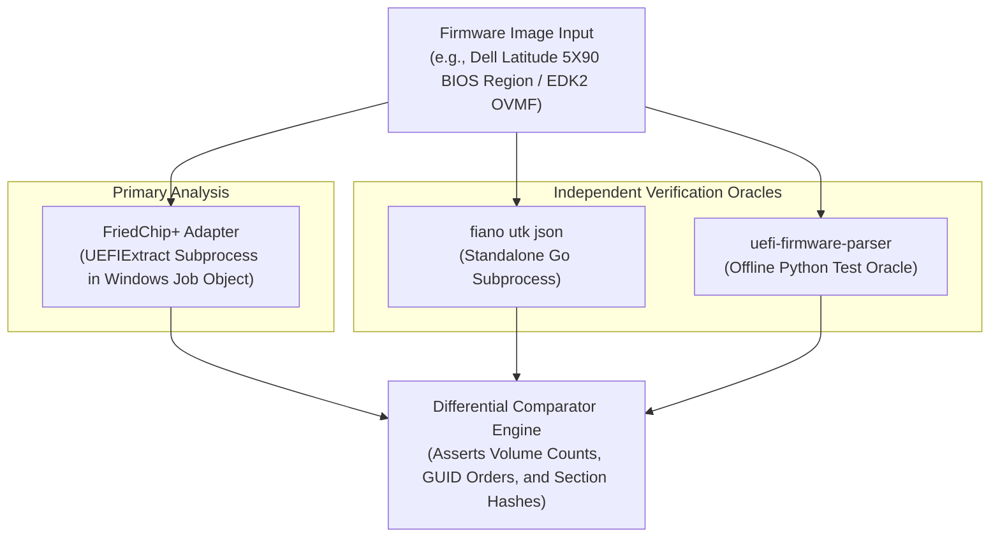

# Phase 3A.1 · UEFI Validation & Test Strategy (Corrected)

**Project:** FriedChip+ Clean-Room Firmware Engineering Workstation  
**Domain:** Quality Assurance, Test Taxonomy, Differential Verification & Fuzzing  
**Milestone:** Phase 3A.1 (Architecture Correction & Reuse-First Review)  
**Author / Engineering Lead:** Sufiyan Khan  
**Status:** COMPLETE TEST STRATEGY DELIVERABLE  
**Scope Restriction:** Test Strategy and Specification Only. Zero code changes in application source tree.

---

## 1. Quality Philosophy & Five Verification Pillars

Firmware parsing in FriedChip+ operates at the critical boundary between untrusted binary inputs and engineering analysis tools. A parser defect can lead to false safety claims, corrupted extraction, or host crashes.

Our verification framework rests on five clearly distinguished testing tiers:

```text
┌────────────────────────────────────────────────────────────────────────┐
│                        FriedChip+ Testing Taxonomy                     │
├──────────────────────────┬─────────────────────────────────────────────┤
│ 1. Synthetic Unit Tests  │ Handcrafted byte slices testing boundary    │
│                          │ edge cases (header offsets, checksums).     │
├──────────────────────────┼─────────────────────────────────────────────┤
│ 2. Real-World Fixtures   │ Authentic OEM dumps (Dell, Lenovo, ASUS,    │
│                          │ EDK2 OVMF) testing end-to-end traversal.    │
├──────────────────────────┼─────────────────────────────────────────────┤
│ 3. Differential Testing  │ Real-time execution of pinned upstream CLI  │
│                          │ tools (UEFIExtract, utk) against identical  │
│                          │ binaries, comparing structured outputs.     │
├──────────────────────────┼─────────────────────────────────────────────┤
│ 4. Mutation Stress Tests │ Deterministic in-tree loops mutating bits,  │
│                          │ sizes, and headers to verify panic-freedom. │
├──────────────────────────┼─────────────────────────────────────────────┤
│ 5. Coverage-Guided       │ Independent harnesses (cargo-fuzz / LLVM    │
│    Fuzzing               │ libFuzzer with ASan) exploring edge states. │
└──────────────────────────┴─────────────────────────────────────────────┘
```

> [!IMPORTANT]
> **Methodological Precision:**
> - Hardcoded expected output files are **regression tests**, not differential tests. True differential testing requires live execution of independent pinned upstream binaries against the same input stream.
> - A deterministic mutation loop is a **mutation stress test**, not equivalent to coverage-guided fuzzing (e.g., `cargo-fuzz` or `libFuzzer` with edge counters and AddressSanitizer).

---

## 2. Normative Specification Invariants & Negative Testing Matrix

| Specification Rule (PI 1.10) | Normative Invariant Requirement | Malicious / Malformed Permutation | Expected FriedChip+ Behavior |
|---|---|---|---|
| **FV Header Signature** | Offset `+0x28` must be `_FVH` (`0x4856465F`). | Corrupted bytes (e.g. `_FVA`, `0x00000000`, `0xFFFFFFFF`). | Rejects candidate as valid FV; continues scanning without panicking. |
| **FV Word Checksum** | Inverted 16-bit word sum across `HeaderLength` must equal zero. | Bit flip in attributes or `FileSystemGuid`. | Rejects volume or marks node `ValidationStatus::Malformed("Checksum mismatch")`. |
| **Block Map Sentinel** | Array of `{ NumBlocks, Length }` must terminate in `{ 0, 0 }`. | Array of non-zero entries exceeding `HeaderLength`. | Flags block map error; bounds extent to minimum safe length. |
| **Block Map Extent Match**| $\sum (\text{NumBlocks} \times \text{Length}) == \text{FvLength}$. | Total block sum smaller or larger than declared `FvLength`. | Marks structural discrepancy; rejects out-of-bounds traversal. |
| **FFS Header Alignment** | Header must start on an 8-byte boundary relative to volume base. | Header located at non-8-byte aligned offset. | Flags alignment violation; marks node `ValidationStatus::Warning`. |
| **FFS Header Checksum** | 8-bit sum across header must equal zero, with `State` and `FileChecksum` as `0x00`. | Byte alteration in GUID or Type. | Rejects file header; logs warning; scans to next 8-byte boundary. |
| **FFS Large File (FFSv3)** | If `FFS_ATTRIB_LARGE_FILE` (`0x01`) is set, `Size[3]` must be zero. | `Size[3]` non-zero or `ExtendedSize` out of volume bounds. | Rejects file header; prevents integer overflow. |
| **FFS Data Checksum** | If `FFS_ATTRIB_CHECKSUM` is clear, file checksum must be `0xAA`. | Checksum is neither valid data sum nor `0xAA`. | Flags checksum anomaly; records diagnostic warning. |
| **Section Size Wrap** | Section size must not exceed remaining FFS payload. | 24-bit section size larger than parent FFS payload. | Truncates section traversal; marks section `Malformed`. |
| **Section Extended Size** | If section `Size[3] == 0xFFFFFF`, 32-bit `ExtendedSize` applies. | Extended size claiming 4GB when parent payload is 64KB. | Truncates traversal; flags out-of-bounds section. |
| **Decompression Bomb** | Uncompressed payload must not exceed memory budget. | 1KB compressed stream claiming 1GB uncompressed size. | Rejects prior to allocation (`AppError::DecompressionBombExceeded`). |
| **IFR VarOffset Semantics**| `VarOffset` is relative to variable store buffer. | Misinterpreted as physical SPI flash address. | Enforces semantic scoping; prevents physical flash corruption claims. |

---

## 3. Automated Differential Testing Strategy

Differential testing compares the parsed hierarchy and extraction results of FriedChip+'s normalization layer against independently executed upstream tools:



### Live Differential Execution Requirements:
1. **Real Binary Execution:** Tests must actually invoke the pinned standalone executables (`UEFIExtract.exe` commit `de73942d`, `utk.exe` commit `162b021e`) on the target image.
2. **Firmware Volume Parity:** The count of verified Firmware Volumes and their container byte offsets must match across `UEFIExtract` and `utk`.
3. **FFS GUID Order Parity:** The ordered sequence of FFS file GUIDs within each volume must match upstream outputs with 100% fidelity.
4. **Decompressed Payload Cryptographic Equivalence:** For standard compressed sections (Tiano, LZMA), decompressed output SHA-256 hashes must match between engines.

---

## 4. Fixture Engineering Pipeline

Test fixtures are structured into three distinct categories:

### Tier 1: Authentic Real-World OEM Images
* **Dell Latitude 5X90 (`fixtures/realworld/Latitude_5X90_1.41.0.exe`):** Authentic Intel 300-Series BIOS region with nested FVs, PEI/DXE cores, and AMI setup forms.
* **EDK2 OVMF (`fixtures/realworld/OVMF.fd`):** Clean reference UEFI build adhering strictly to PI Specification 1.10.
* **Execution Rule:** Marked `#[ignore]` in default CI runs; executed explicitly during full regression testing.

### Tier 2: Synthetic Golden Vector Fixtures
* Handcrafted binary buffers generated by `SyntheticFixtureBuilder`:
  - `build_valid_fv_image`: Deterministic 1MB FV with valid block map, correct checksum, and standard FFS files.
  - `build_ffsv3_large_file_image`: Synthetic FV containing an `EFI_FFS_FILE_HEADER2` with `FFS_ATTRIB_LARGE_FILE` and zero `Size[3]`.
  - `build_corrupt_checksum_fv_image`: FV with deliberate single-bit checksum corruption.
  - `build_nested_fv_image`: Encapsulation section holding a second nested FV.

### Tier 3: Adversarial Mutation Vectors
* Deterministic in-tree mutation stress testing exercising header boundary mutations, bit flips, and size wraps.

---

## 5. Diagnostic Audit: Cargo Test Execution Log

During the preflight execution of this engineering milestone, three command attempts were logged while verifying the test suite:

1. **Attempt 1:** `cargo test --quiet`
   - *Result:* Command exited with code 1.
   - *Error:* `cargo : The term 'cargo' is not recognized as the name of a cmdlet...`
   - *Diagnosis:* **Environmental / PATH Error.** The default PowerShell execution environment did not have `$HOME\.cargo\bin` exported in its process PATH.
2. **Attempt 2:** `& "$env:USERPROFILE\.cargo\bin\cargo.exe" test --quiet`
   - *Result:* Command exited with code 1.
   - *Error:* `error: could not find Cargo.toml in C:\Users\xtrar\Desktop\LBE Re-engineer or any parent directory`
   - *Diagnosis:* **Working Directory / Invocation Path Error.** The workspace root is a multi-language project container where `Cargo.toml` is located inside `src-tauri/Cargo.toml`, not in the repo root.
3. **Attempt 3:** `& "$env:USERPROFILE\.cargo\bin\cargo.exe" test --manifest-path src-tauri/Cargo.toml --quiet`
   - *Result:* **Command exited with code 0 (Success).**
   - *Execution Output:*
     ```text
     running 75 tests
     i...........................................i..............................
     test result: ok. 73 passed; 0 failed; 2 ignored; 0 measured; 0 filtered out; finished in 25.70s
     ```
   - *Diagnosis:* **All 73 active tests passed cleanly.** Zero code or regression failures occurred. The preceding errors were purely command invocation and environment path configuration errors.

---
EOF