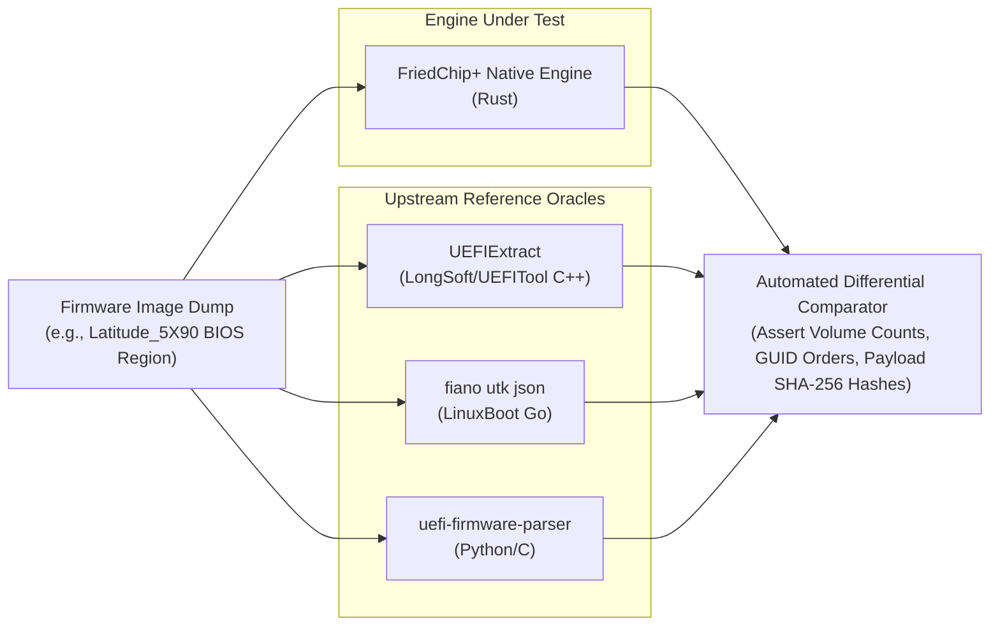

# Phase 3A · UEFI Validation & Test Strategy

**Project:** FriedChip+ Clean-Room Firmware Engineering Workstation  
**Domain:** Quality Assurance, Negative Testing, Differential Verification & Fuzzing  
**Milestone:** Phase 3A (Upstream Component Intelligence & Architecture Design)  
**Author / Engineering Lead:** Sufiyan Khan  
**Status:** COMPLETE TEST STRATEGY DELIVERABLE  
**Scope Restriction:** Test Strategy and Specification Only. Zero code changes in application source tree.

---

## 1. Quality Philosophy & Verification Pillars

Firmware parsing in FriedChip+ operates at the boundary between untrusted binary inputs and mission-critical engineering tooling. A parser defect can lead to false safety claims, corrupted extraction, or host crashes.

Our verification framework rests on four independent pillars:
1. **Normative Specification Invariant Validation:** Rigorous mathematical assertion of PI Specification Volume 3 invariants (word checksums, block map consistency, alignment).
2. **Adversarial Negative Testing:** Deterministic permutation of truncated, corrupt, and malicious structures to verify robust error propagation and panic freedom.
3. **Automated Differential Testing:** Cross-validation of parsed trees and extracted payloads against trusted upstream test oracles (`UEFIExtract`, `fiano utk`).
4. **In-Tree Bounded Mutation Fuzzing:** Continuous in-process stress testing exercising parser branch coverage without external fuzzing harnesses.

---

## 2. Normative Invariants & Negative Testing Matrix

| Invariant / Test Scenario | Normative PI Specification Rule | Malicious / Malformed Permutation | Expected FriedChip+ Behavior |
|---|---|---|---|
| **FV Header Signature** | Offset `+0x28` must be `_FVH` (`0x4856465F`). | Corrupted bytes (e.g. `_FVA`, `0x00000000`, `0xFFFFFFFF`). | Rejects volume immediately; returns `AppError::Binary("Invalid FV signature")`. |
| **FV Header Checksum** | Inverted 16-bit word sum across `HeaderLength` must equal zero. | Bit flip in header attributes or GUID. | Rejects volume or marks `ValidationStatus::Malformed("Checksum mismatch")`. |
| **Block Map Sentinel** | Block map array must terminate with `{ NumBlocks: 0, BlockLength: 0 }`. | Array of non-zero entries exceeding `HeaderLength` without `{0, 0}`. | Rejects volume with `AppError::Binary("Missing block map sentinel")`. |
| **Block Map Length Match**| $\sum (\text{NumBlocks} \times \text{BlockLength}) == \text{FvLength}$. | Total block length smaller or larger than declared `FvLength`. | Flags structural discrepancy; bounds parsing to minimum safe extent. |
| **Truncated Header** | Buffer must contain at least `HeaderLength` bytes. | Truncated file containing 32 bytes when `HeaderLength` claims 96 bytes. | Rejects with `AppError::Binary("Buffer truncated before header end")`. |
| **FFS Header Checksum** | 8-bit sum of all bytes in `EFI_FFS_FILE_HEADER` must equal zero. | Single-byte alteration in file GUID or type. | Rejects file header; logs diagnostic warning; scans for next alignment boundary. |
| **FFS File Alignment** | Files must begin on $2^{\text{Alignment}}$ byte boundaries. | File header positioned on misaligned offset. | Flags alignment violation; marks node `ValidationStatus::Warning`. |
| **Extended FFSv3 Size** | If 3-byte size is `0xFFFFFF`, 64-bit size field must be within container. | Extended size claiming 18 Exabytes (`0xFFFFFFFFFFFFFFFF`). | Detects integer overflow; rejects with `AppError::Binary("Extended FFS size out of bounds")`. |
| **Section Size Wrap** | Section size must not exceed remaining FFS file payload. | 3-byte section size larger than parent FFS payload. | Truncates section traversal; marks section `Malformed`. |
| **Decompression Bomb** | Uncompressed payload must not exceed memory budget. | 1KB compressed stream claiming 4GB uncompressed size. | Rejects prior to allocation (`AppError::DecompressionBombExceeded`). |
| **Corrupt Tiano Stream** | Huffman table definitions must be strictly bounded and valid. | Truncated bitstream, invalid Huffman code, negative LZ offset. | Returns `AppError::DecompressionFailure` cleanly without panic or out-of-bounds read. |
| **Cyclic Nested Volumes** | Section containing nested FV must strictly descend linearly. | Encapsulation section referencing parent container offset. | Cycle detection stops traversal; rejects recursion. |

---

## 3. Automated Differential Testing Strategy

Differential testing compares FriedChip+'s native Rust engine outputs against established reference implementations:



### Differential Verification Invariants:
1. **Firmware Volume Count & Offsets:** FriedChip+ must discover the exact same number of root and nested Firmware Volumes as `UEFIExtract` and `utk`, matching byte offsets identically.
2. **FFS File GUID Decomposition:** The sequence of FFS file GUIDs extracted within each volume must match upstream reference oracles with 100% fidelity.
3. **Decompressed Payload Cryptographic Equivalence:** For every compressed section (Tiano, EFI, LZMA), the decompressed payload emitted by FriedChip+ must match the SHA-256 hash of the payload decompressed by `UEFIExtract`.

---

## 4. Fixture Engineering Pipeline

To satisfy Karpathy Guidelines and avoid brittle test environments, test fixtures are organized into three strictly categorized tiers:

### Tier 1: Real-World OEM Integration Fixtures
- **Canonical Fixture:** `fixtures/realworld/Latitude_5X90_1.41.0.exe` (Dell Latitude 5X90 1.41.0).
- **Extracted BIOS Region:** Authentic Intel 300-Series SPI BIOS Region containing multiple nested Firmware Volumes, PEI Core, DXE Core, SMM drivers, and AMI Setup IFR packages.
- **Execution Policy:** Configured with `#[ignore]` in default test runs to allow instant test execution in lightweight CI; executed explicitly via `cargo test -- --ignored` when the proprietary binary is available on disk.

### Tier 2: Synthetic Golden Vector Fixtures
- **Builder:** `SyntheticFixtureBuilder` in `src-tauri/src/engine/testing/fixture_builder.rs`.
- **Vectors Generated:**
  * `build_valid_fv_image`: Deterministic 1MB Firmware Volume with valid block map, correct word checksum, 3 FFS files (PEI Core, DXE Driver, Raw Data), and compressed sections.
  * `build_truncated_fv_image`: FV with valid signature but truncated before block map end.
  * `build_corrupt_checksum_fv_image`: FV with deliberate bit flip in attributes.
  * `build_nested_fv_image`: FV containing an FFS file with an encapsulation section holding a second nested FV.

### Tier 3: Adversarial Fuzzing Vectors
- Bounded in-process mutation engine applying bit-flips, byte-insertions, boundary-edge overrides (`0x00`, `0x7F`, `0x80`, `0xFF`), and size mutations.

---

## 5. In-Tree Bounded Fuzzing Framework

To ensure the UEFI parser is panic-free and robust against arbitrary inputs without requiring external tools (`cargo-fuzz` or Linux-only AFL), FriedChip+ incorporates an **In-Tree Bounded Fuzzing Test** runnable via standard `cargo test`:

```rust
#[test]
fn test_in_process_bounded_uefi_parser_stress_fuzzing() {
    let mut rng = DeterministicRng::new(0xUEF1_2026);
    let base_image = SyntheticFixtureBuilder::build_valid_fv_image();

    for iteration in 0..10_000 {
        let mut mutated = base_image.clone();
        apply_structural_mutations(&mut mutated, &mut rng);

        // Invariant: Parser must NEVER panic, abort, or trigger memory faults
        let _ = FirmwareVolume::parse_at(&mutated, 0);
    }
}
```

### Mutation Strategies:
1. **Header Boundary Shifts:** Mutate `HeaderLength` and `FvLength` to extreme values (`0`, `0xFFFF`, `usize::MAX`).
2. **Block Map Permutations:** Omit the `{0, 0}` sentinel; inject block lengths exceeding buffer bounds.
3. **Checksum Tampering:** Flip single bits in the checksum field to verify deterministic rejection.
4. **Section Compression Corruption:** Truncate compressed streams; inject invalid Huffman symbols to verify graceful decompression aborts.

---
EOF
